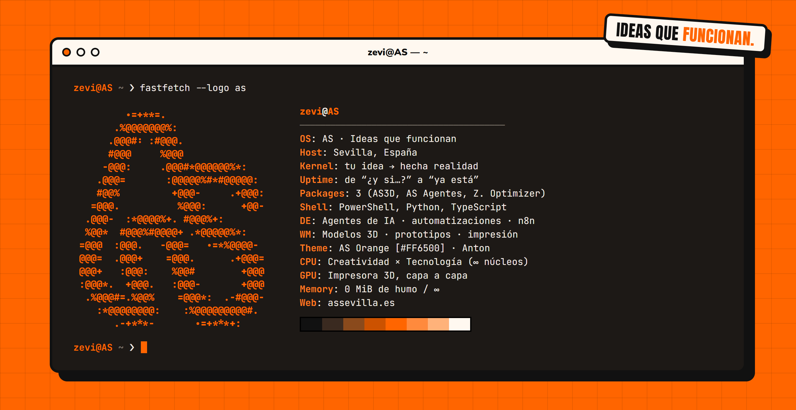

  <b>Tu idea. Hecha realidad.</b> 
  En <a href="https://assevilla.es">AS</a> creamos agentes de IA, automatizaciones y modelos 3D a medida. 
  Sin humo: escuchamos, construimos y hacemos que funcione.

  
  

### ❯ ls ~/proyectos

| | Proyecto | Qué es |
|---|---|---|
| 🟧 | **[Z. Optimizer](https://github.com/zevidaun/Z.-Optimizier)** | Optimizador de Windows 11 sin humo: código abierto, sin red y 100 % reversible |
| 🟧 | **[AS3D](https://assevilla.es/as3d/)** | Gestión para negocios de impresión 3D |
| 🟧 | **AS Agentes** | Agentes de IA para atención al cliente, automatizaciones, CRM e informes |

### ❯ cat stack.txt

  
  
  
  
  
  
  

La imagen de arriba se genera desde <a href="assets/src">assets/src</a> (HTML + el logo de AS convertido a ASCII).
